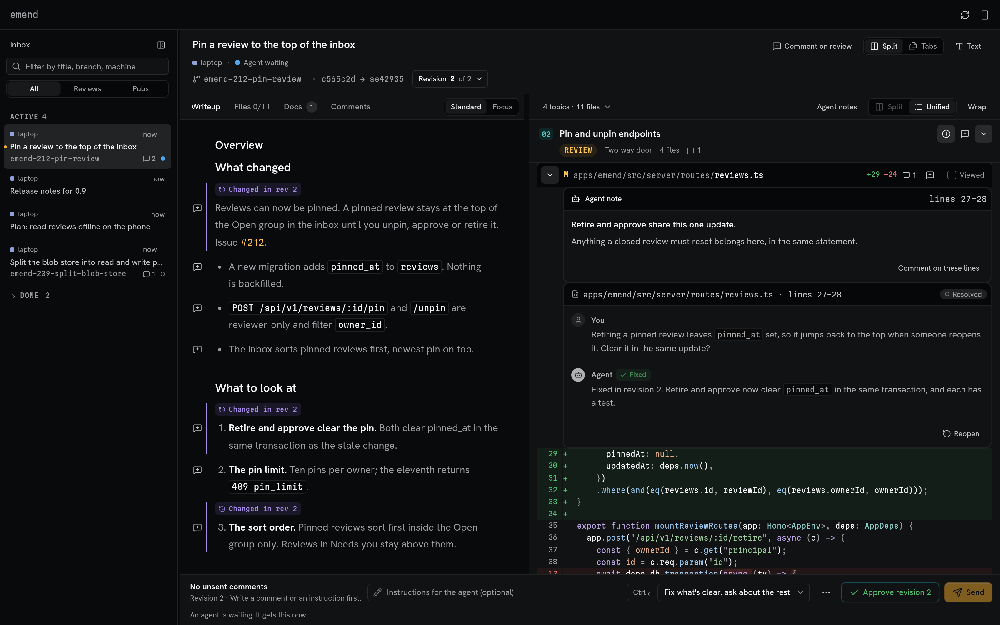
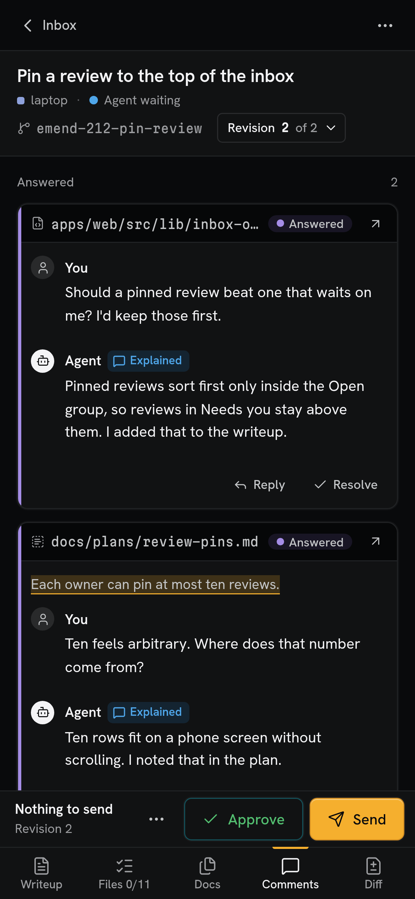

# emend

Open-source, local-first review for work done by coding agents: plans, docs and code. Read the
agent's writeup next to its diff, comment on any of it, press Send, and the waiting agent gets your
feedback. emend starts on your machine with one command. Machines can attach to a hub, so that you
review from any device, your phone included.

<p>
  
  
</p>

[VISION.md](https://github.com/shllg/emend/blob/main/VISION.md) says what emend is for, and what it
is not.

emend grew out of [hunk-review-skill](https://github.com/vendis-ai/hunk-review-skill), which stays
maintained alongside it.

## Requirements

Linux or macOS, Node.js 24.18 or newer and git 2.44 or newer.

## Quick start (one machine)

On macOS, install Node.js and git from Homebrew first:

```sh
brew install node git
```

Then install emend, start it and add its skills:

```sh
npm install -g @shllg/emend
emend --version
emend service install
emend
claude plugin marketplace add shllg/emend@release
claude plugin install emend@emend
emend skills install
```

With mise activated in your shell, install with `mise use -g npm:@shllg/emend` instead of the
`npm` line. `emend service install` runs the server at login, which is recommended. `emend` prints a
one-time sign-in link. The two `claude plugin` lines add the skills to Claude Code, and
`emend skills install` adds them for Codex and other agents that read `~/.agents/skills`.

If `node --version` is older than 24.18 or `git --version` older than 2.44, as on many Linux
distributions and with Apple's git on macOS, follow step 1 of
[local.md](https://github.com/shllg/emend/blob/release/docs/setup/local.md#1-install-nodejs-and-git)
first.

The full walkthrough, with a prompt that lets Claude Code or Codex do it with you, is
[docs/setup/local.md](https://github.com/shllg/emend/blob/release/docs/setup/local.md).

## Pick your setup

Each setup has its own page for Linux and macOS, with a copy-paste prompt for your agent.
[docs/setup.md](https://github.com/shllg/emend/blob/release/docs/setup.md) is the index, with the
one-prompt setup.

| Setup | Suits you if |
|---|---|
| [One machine](https://github.com/shllg/emend/blob/release/docs/setup/local.md) | You try emend or review agent work on the machine where the agents run. |
| [Your own hub on Tailscale](https://github.com/shllg/emend/blob/release/docs/setup/hub-tailscale.md) | You have an always-on machine and want to review from your phone and other devices. |
| [Attach more machines](https://github.com/shllg/emend/blob/release/docs/setup/attach.md) | You run a hub and want the agents on your other machines to publish to it. |
| [Set up your agents](https://github.com/shllg/emend/blob/release/docs/setup/agents.md) | emend runs and you want Claude Code, Codex or others to use it. |
| [Develop emend from a checkout](https://github.com/shllg/emend/blob/release/docs/setup/development.md) | You change emend itself or run it from a clone. |
| [Update](https://github.com/shllg/emend/blob/release/docs/setup/update.md) | A new version is out. |
| [Troubleshooting](https://github.com/shllg/emend/blob/release/docs/setup/troubleshooting.md) | A setup or update step fails. |
| A hub on your own network (a LAN address or your own HTTPS proxy) | Not supported yet; planned. Today Tailscale is the supported way to reach a hub from other devices. |

## Update

```sh
npm install -g @shllg/emend@latest
claude plugin marketplace update emend
claude plugin update emend@emend
```

With mise, run `mise upgrade npm:@shllg/emend` instead of the `npm` line. If you installed the
service, run `emend service install` again; it keeps its options. Without the service, run
`emend stop`; the next `emend` starts the new version. If you ran `emend skills install`
before, run it again. Then restart Claude Code. After `brew upgrade node` or `mise upgrade node`,
run `emend service install` again too.

[docs/setup/update.md](https://github.com/shllg/emend/blob/release/docs/setup/update.md) covers the
order for a hub and its machines, Node.js upgrades and the phone app.

## Uninstall

Remove what a setup added with its Undo section: [one machine](https://github.com/shllg/emend/blob/release/docs/setup/local.md#undo)
and [your agents](https://github.com/shllg/emend/blob/release/docs/setup/agents.md#undo). The Undo
sections of the hub and attach pages cover those setups.

## Usage

[docs/usage.md](https://github.com/shllg/emend/blob/release/docs/usage.md) covers `emend config`
and publishing docs for review.

## Development

[Develop emend from a checkout](https://github.com/shllg/emend/blob/release/docs/setup/development.md)
covers installing from a checkout, the plugin from a checkout and the checks.
[AGENTS.md](https://github.com/shllg/emend/blob/main/AGENTS.md) holds the working rules.
Maintainers: [docs/releasing.md](https://github.com/shllg/emend/blob/main/docs/releasing.md) holds
the release policy and checklist.

## License

MIT. See [LICENSE](https://github.com/shllg/emend/blob/main/LICENSE).
