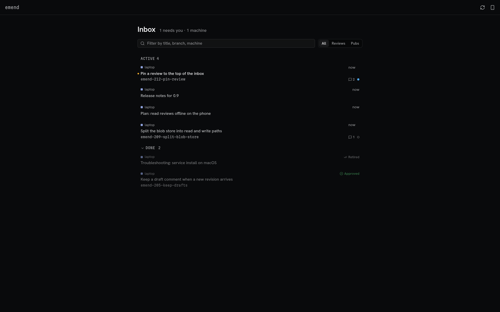
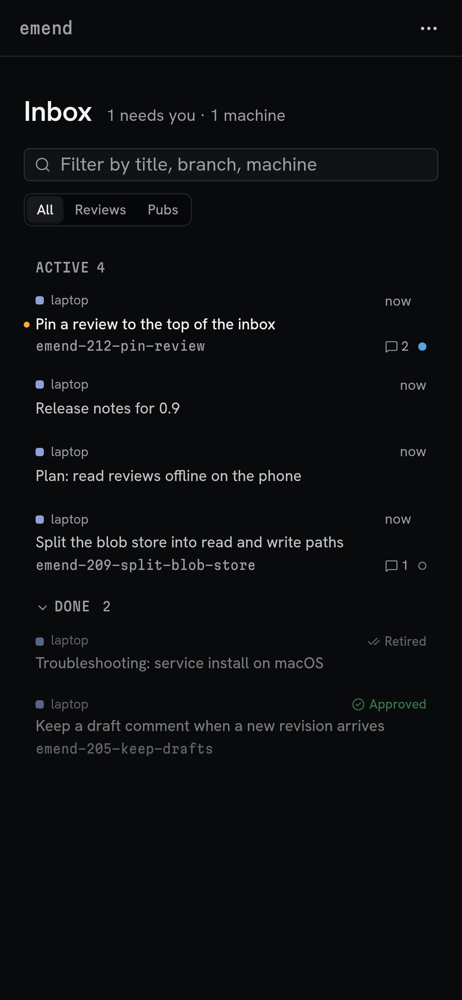
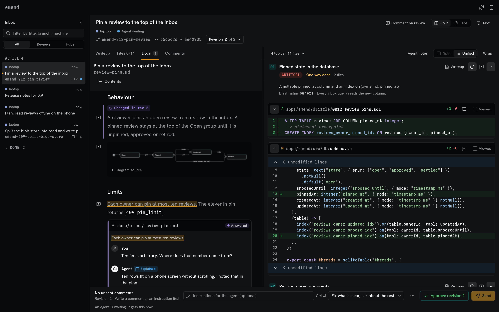
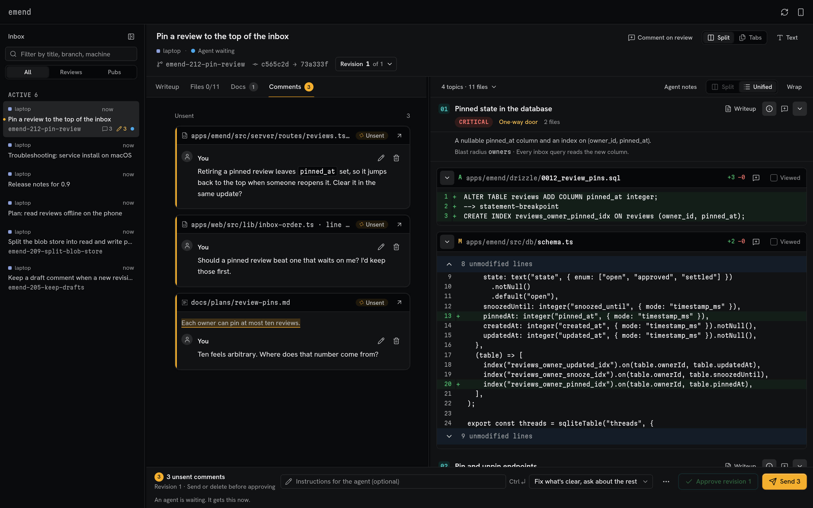

# Using emend

Day-to-day use of the `emend` command: its settings, and how to publish a doc for review. To
install and set up emend first, start with [setup.md](setup.md).

## Configure

`emend config` lists the settings. `emend config add docRoots <folder>` lets agents publish docs
from a folder outside their repository. `emend config set openBrowser true` makes `emend` open your
browser instead of printing a one-time sign-in link. Run these yourself, never through an agent:
they change what your agents may publish.

## Publish a doc

Publish any UTF-8 text file and get its review URL:

```sh
emend publish docs/plan.html
```

It prints the review URL, such as `http://127.0.0.1:3636/r/<review-id>`.

Run the same command after editing the file to add a revision at the same URL. Use `--key plan`
to keep one review when the generated file's path changes, or `--new` to start a separate review.
`--review <id>` updates a review directly. Add `--json` for the full result; the `--manifest` form
continues to print JSON. Markdown and HTML render by default; other text files show their whole
source with line numbers and syntax highlighting where available. `--source` shows every doc as
source, including Markdown and HTML, in the path shortcut only. It cannot combine with
`--manifest`; a manifest sets `view: "source"` per doc instead. For example,
`emend publish --source notes.md` keeps Markdown syntax literal. Source docs must be valid UTF-8
without NUL and at most 1 MiB; explicitly named binary files are refused. A folder walk skips names
that look like secrets (Markdown and HTML files publish whatever their name), folders named exactly
`secret`, `secrets`, `credential` or `credentials` in any case below the folder argument, binary
files, files that are too large or unreadable, and files shown as source that hold a private key
(walked Markdown and HTML that render are not scanned). Below a folder argument, an HTML asset
inside such a folder or holding a private key is not uploaded either. A file or folder named
explicitly is published as named, so never name a credential file or a secrets folder explicitly.
Name a public file the walk skipped, such as `passwords.ts`, to publish it. Skip warnings stop
after 20 (`SHORTCUT_LIMITS.warnings`), followed by a count of additional skips. Each folder argument still gets a summary line counting the published files.
CSS and JavaScript files in a folder also appear as source docs, even when an HTML doc
uses them as assets.

You can name several files or a folder. A folder bundles its visible text files with the
assets those HTML docs reference; dotfiles, `.git/` and `node_modules/` are skipped. Symlinks
leaving the folder are refused. A folder of HTML docs keeps its links and images; Markdown docs
in a folder do not link to each other or show local images yet.

The default key uses the instance and the sorted, distinct real input paths, so reordering the
arguments keeps the URL. Adding files inside a named folder also keeps it; changing the set of
input paths needs `--key` to keep one review.

`--main <path>` selects the opening doc, using its bundled path or its path from the current
directory. Otherwise emend picks the only doc, `index.html`, the only HTML doc, `index.md`,
`README.md`, the only Markdown doc, then the first doc in path order. The title comes from
`--title`, that doc's HTML title or first Markdown `#` heading, then its filename, capped at 200
characters. A source main doc uses its filename as the inferred title.

Docs must be in the current worktree or an allowed `docRoots` folder. For another folder, run
`emend config add docRoots <folder>` yourself first; temporary folders need permission too.
Publishing while the server is stopped saves the review and prints its URL; run `emend` or
`emend service install` to open it. An attached machine publishes to its hub.

## List your reviews and check the connection

`emend ls` lists the reviews this machine published, newest first, one line each: id, state, last
update, title and URL. It also lists snoozed and finished reviews, and it never shows comments. The
update time is UTC. Add `--json` for one JSON object with an `items` list. It shows at most the
newest 100.

`emend status` shows whether this machine is `local` or `attached`, the server or hub address,
the hub name when attached, this machine's instance name, whether the server or hub answers, and
the `emend` version. Add `--json` for the same fields as JSON, where `address: none` and
`instance: none` in the human form are `null`. It prints no token, creates no file, and reports a
server or hub that does not answer instead of failing.

## Stop the server

`emend stop` stops the server that `emend` started on this machine, for example after an update so
the next `emend` runs the new version. It does not stop a server the service runs: run
`emend service install` to restart that one, or `emend service uninstall` to stop it. When no
server runs, it removes a Tailscale Serve route that a crashed `emend serve --tailscale` left.

## A look around

The inbox lists every review and published doc, with the ones that need you first. A phone shows
the same groups as a desktop.

<p>
  
  
</p>

A plan or other doc that comes with a review opens next to its diff, with its diagrams drawn and
your comments beside the text.



Comments stay unsent until you press Send. The Comments tab lists them, and the Send bar lets you
pick how the agent should act on them.


