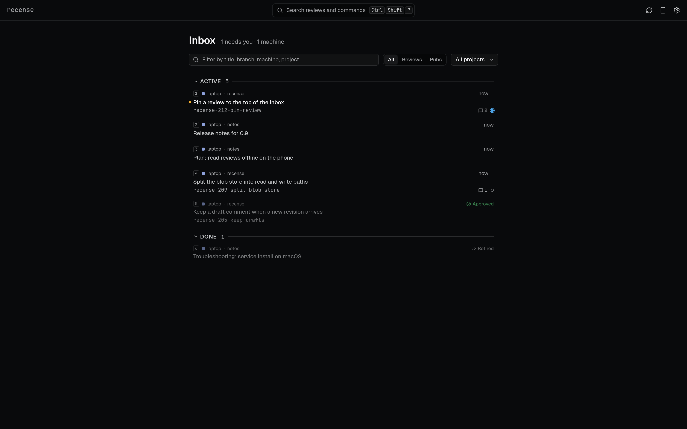
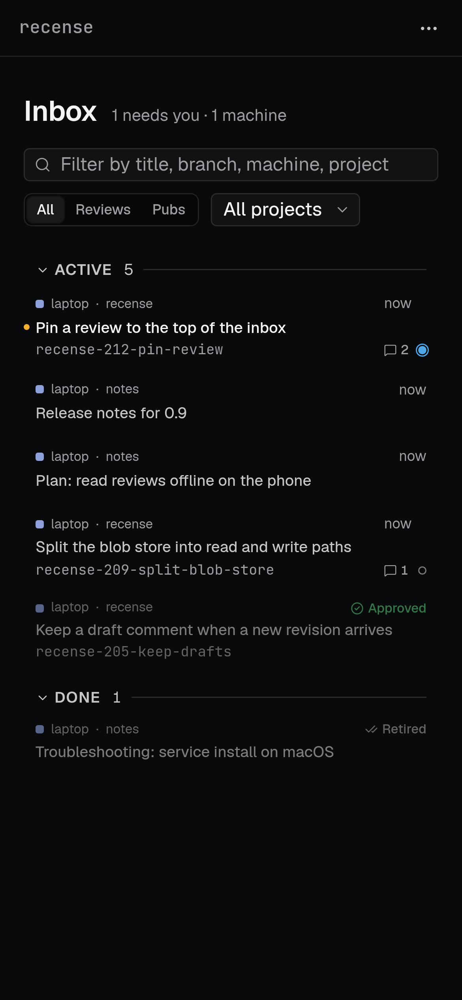
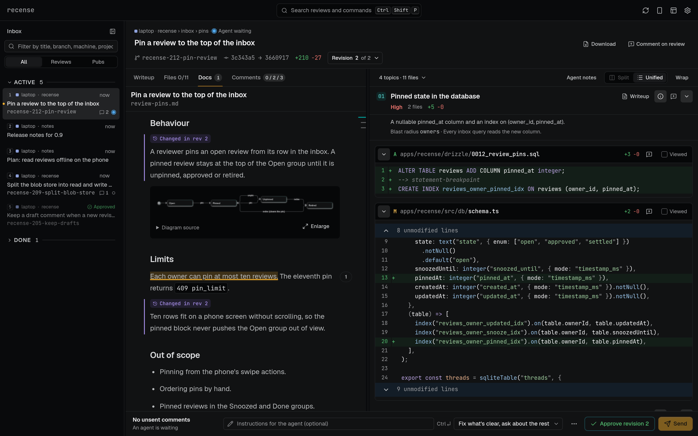
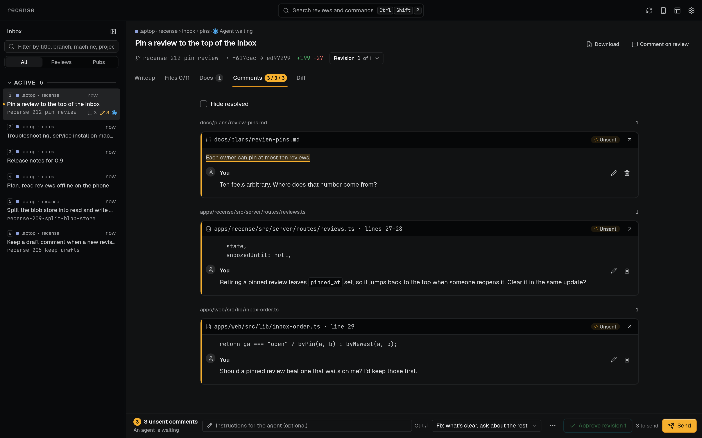

# Using emend

Day-to-day use of the `emend` command: its settings, and how to publish a doc for review. To
install and set up emend first, start with [setup.md](setup.md).

## Configure

`emend config` lists the global configuration. `emend config add docRoots <folder>` lets agents publish docs
from a folder outside their repository. `emend config set openBrowser true` makes `emend` open your
browser instead of printing a one-time sign-in link. Run these yourself, never through an agent:
they change what your agents may publish.

The old state-folder config is copied once, only if the global config is missing, then renamed
`config.json.migrated`. An existing global config wins without merging the old file.
`EMEND_HOME` moves only state; set `XDG_CONFIG_HOME` too for a separate config.
For `docRoots` and `openBrowser`, publish and bare `emend` ignore a global config whose path or
links lie inside a repository holding the working directory, and warn. `emend config` refuses
there. An old state config inside such a repository is never read, copied or renamed.
A home-rooted dotfiles repository does not count. The server reads only `approvedActiveHours`, `approvedActiveLimit` and `keys`
from the file and does not apply this check. A config path set by a repository's environment
is not detected when emend runs from a folder outside every repository.
If `XDG_CONFIG_HOME` is absolute, `emend service install` records it at install time.
Reinstall the service after changing it.

Approved reviews stay in Active for 12 hours by default. Set `approvedActiveHours` in the global
config file to whole hours from 0 to 720, or use Settings → Inbox to override it for this server;
Reset falls back to the file, then the default, and 0 moves approvals out of Active at once.
Active keeps at most 5 approved reviews by default, choosing the newest approvals. Set
`approvedActiveLimit` in the global config file to a whole number from 0 to 200, or override it
in Settings → Inbox; 0 keeps none.

Active shows reviews that need you first (agent waiting, then unsent comments), followed by
To review, Answered and Approved. The newest change comes first inside each group.
A pub stays in To review after you send comments on it.

Keyboard shortcuts work on desktop and tablet. Press `?` to list them. Settings → Keyboard shortcuts
changes, turns off or resets a key. Alt+1 to Alt+9 (⌥1 to ⌥9 on a Mac) open the first nine rows
of Active, top to bottom, as the small numbers in the inbox, the inbox pane and the collapsed rail
show, counting only the rows shown when a filter is set. The rail ignores Kind and search.
emend keeps these keys while its page has focus, also where the browser uses them to switch tabs.
Settings can switch them to Ctrl (⌘ on a Mac) or turn them off to give them back to the browser.
Ctrl+Shift+P (⌘⇧P on a Mac) opens the command palette. Type a few letters of a command, or find
reviews and pubs by title, branch, project or machine. An issue number finds the branch that carries
it. Done items appear after active ones. Move with the arrow keys and press Enter to open the chosen
item or run the command. Firefox keeps that key for a private window, so pick another one in
Settings there. In the config file, use
`"keys": { "inbox.next": "j", "file.toggleViewed": "shift+v", "review.snooze": null }`.
`null` turns a shortcut off. A key is one letter, digit or punctuation character, or `shift+`,
`mod+` or `mod+shift+` followed by a letter, or `alt+` or `mod+` followed by a digit.
`mod` means Ctrl, or ⌘ on a Mac.
See [api.md](api.md) for the command ids.

### Themes

To make your own theme, ask a coding agent such as Claude Code or Codex.
Settings → Appearance shows the text to paste, with a Copy button.
It links to the [emend-theme skill](skills/emend-theme/SKILL.md) at the running version's tag,
or at `main` for a build without a release.
Write what you want after "What I want:". This example links to `main`:

```text
Make me a custom theme for emend. Read the skill at https://raw.githubusercontent.com/shllg/emend/refs/heads/main/docs/skills/emend-theme/SKILL.md and follow it.

What I want: a dark theme called forest, with deep green backgrounds and a warm amber accent. Keep it easy to read.
```

Other wishes work the same way, such as "a light theme called paper, with warm off-white
backgrounds and blue links" or "a theme called mono, based on Dark, with Iosevka for code and
Inter for text". The agent copies Dark, Light or one of your themes with `emend theme copy`,
changes only what you asked for and runs `emend theme check` until the theme is valid.
The skill is never installed. Then pick the theme in Settings → Appearance.

Themes live in the `themes` folder beside emend's global `config.json`, on the server your
browser reaches. `emend theme copy dark mine` writes `themes/mine/theme.json`.
You can also use `light` or another theme as the source. Each theme has its own folder.
`emend theme list` shows valid and refused themes. `emend theme check mine` reports
invalid values and text that is too faint to read, including syntax colours on `bg-sunken` code blocks,
diff lines, changed words, hovered lines (including context lines on `bg-hover` over `bg-surface`)
and selected lines.
Body text and plain code need 4.5 to 1 contrast; the seven syntax highlight colours need 3 to 1.
Inserted and deleted code tokens (`diff-add-fg` / `diff-del-fg`) need 3 to 1 on `bg-sunken`.
Docs shown as source check all ten code colours on `bg-reading`, and on commented rows'
`mark-bg` and active or selected rows' `accent-tint`, each composited over `bg-reading`:
plain code needs 4.5 to 1; the other nine colours need 3 to 1.
Diagram text colours `fg-1`, `fg-2` and `fg-3` must be opaque: the frame receives one colour per
Mermaid variable, and Mermaid draws it on several backgrounds. They need 4.5 to 1 on `bg-surface`
and `bg-sunken`. `fg-1` also needs 4.5 to 1 on `topic-bg-2` for notes, composited over both
`bg-surface` and the diagram's `bg-sunken`. Mermaid draws edge-label and state-label boxes at
half opacity over the diagram background; no check covers that blend yet.
The Download also checks `fg-reading` and
`fg-reading-strong` at 4.5 to 1, and `fg-reading-muted` at 3 to 1, on `bg-sunken` and on
`diff-add-bg` / `diff-del-bg` composited over `bg-sunken`.

The CLI commands refuse a themes folder whose path, real path or symlink hops lie inside a repository
holding the working directory, with the same home-rooted dotfiles exception as `emend config`.
The server reads this folder without that check, like `keys` and `approvedActiveHours`.

Edit `themes/mine/theme.json` to change colours or set `fonts.text` and `fonts.code` to a built-in font
(Geist, Inter, Roboto, Atkinson Hyperlegible Next, JetBrains Mono, Geist Mono, Roboto Mono or Fira Code)
or an installed font name.
Built-in names use emend's copy even when that font is installed.
The built-in files cover Latin and most Latin Extended letters in upright text.
Italic files cover basic Latin and Latin-1 only.
Most Vietnamese letters with tone marks and other scripts fall back to a system font.
To use another font on every device, including your phone, put its files in `themes/fonts/` and name them in `fonts.files`;
see [api.md](api.md#themes) for the format and limits. `emend theme check mine` reports missing or refused font files.
Emend's fonts stay as fallbacks. Each file names a Dark or Light base; omitted values use that
base. A token can reference a scale step, so changing that step recolours every token built on
it. A token set to a colour keeps its own value. The surfaces `bg-app`, `bg-surface`, `bg-sunken`,
`bg-raised`, `bg-reading`, `bg-reading-card` and `bg-inverse`, and the diagram text colours `fg-1`,
`fg-2` and `fg-3`, must be opaque, including when set through a scale reference.
See [api.md](api.md#themes) for the file format and readability pairs.

A theme can set `density` to `"compact"`, `"regular"` (the default) or `"roomy"` to change spacing, never text size.
On touch screens, compact keeps regular spacing so tap targets keep their size.

Emend lists up to 50 theme folders in name order. Each `theme.json` is at most 32 KiB.
The names `system`, `dark`, `light` and `fonts` are reserved.
The shared `fonts` folder, top-level files and dot entries are ignored. A symlink counts only when it points to a folder;
links to files, missing targets and link loops are skipped like top-level files.
Keep the `themes` folder at 1000 entries
or fewer, including hidden files and other entries; a larger folder shows a folder error and no themes.

Pick the theme in Settings → Appearance on each device, including your phone. Saving the file
updates open pages within a few seconds. Before accepting HTTP requests, the server waits at
most one second for a baseline of the themes. A baseline ready in time sends no event. If
it takes longer, the server starts anyway. The first fingerprint keeps running and sends one
theme event when it finishes. Stopping the watcher prevents that event. The server checks every
two seconds after the wait, even without open pages, and skips checks while one is running. A
hung fingerprint leaves the watcher idle without blocking server startup or shutdown.

Each tab runs one theme fetch at a time. It fetches at start, when the picked name changes in
this or another tab, on a theme event, and when the event stream opens. Several triggers during
a fetch queue one more fetch after it ends. Results count only for the name still picked when
they arrive. An error keeps the current version and waits for another trigger. Stopping the sync
aborts its fetch and ignores its result; System, Dark and Light need no theme fetch.

Each tab keeps its own last valid version. It ignores other tabs' saved copies of a theme it
already holds. The browser saves a bare `ThemeValid` in `emend.theme.custom`, without a timestamp.
That saved copy seeds a tab at load or on a switch to a theme it does not hold, if the name matches.
The tab parses it only when it needs a seed and the text or name changed. After a fetch for the
still-picked name, a valid entry updates the held version and the saved copy if they differ.
Identical writes are skipped. An unchanged state causes no notification or CSS update. If a file
becomes invalid or disappears, the tab keeps its held version and Settings shows why.

Selecting in Settings keeps the version the tab holds for that name, else adopts a matching
saved copy, else uses the selected entry. It saves that version before writing the pick so other
tabs can find it. The pick change starts a sync. Settings' list has its own query; theme events
cancel any pending list fetch before refreshing it. Stream open also refreshes older queries.
The pick applies to this device only.

Download links read the tab's store. System passes no theme; Dark and Light pass themselves.
A custom name is passed when the tab's check for that name found it valid. Otherwise the link
uses the base of its held version for that name, or passes no theme if none is held. See the API's
[Themes section](api.md#themes) for the complete pairs and sync rules.

## Publish a doc

Publish any UTF-8 text file and get its review URL:

```sh
emend publish docs/plan.html
```

It prints the review URL, such as `http://127.0.0.1:3636/r/<review-id>`.

Run the same command after editing the file to add a revision at the same URL. Use `--key plan`
to keep one review when the generated file's path changes, or `--new` to start a separate review.
`--review <id>` updates a review directly. Add `--json` for the full result; the `--manifest` form
continues to print JSON. Markdown and HTML render by default; other text files show their whole
source with line numbers and syntax highlighting where available. `--source` shows every doc as
source, including Markdown and HTML, in the path shortcut only. It cannot combine with
`--manifest`; a manifest sets `view: "source"` per doc instead. For example,
`emend publish --source notes.md` keeps Markdown syntax literal. Source docs must be valid UTF-8
without NUL and at most 1 MiB; explicitly named binary files are refused. A folder walk skips names
that look like secrets (Markdown and HTML files publish whatever their name), folders named exactly
`secret`, `secrets`, `credential` or `credentials` in any case below the folder argument, binary
files, files that are too large or unreadable, and files shown as source that hold a private key
(walked Markdown and HTML that render are not scanned). Below a folder argument, a doc asset
inside such a folder or holding a private key is not uploaded either. A file or folder named
explicitly is published as named, so never name a credential file or a secrets folder explicitly.
Name a public file the walk skipped, such as `passwords.ts`, to publish it. Skip warnings stop
after 20 (`SHORTCUT_LIMITS.warnings`), followed by a count of additional skips. Each folder argument still gets a summary line counting the published files.
CSS and JavaScript files in a folder also appear as source docs, even when an HTML doc
uses them as assets.

You can name several files or a folder. A folder bundles its visible text files with the
images and assets its documents reference; dotfiles, `.git/` and `node_modules/` are skipped. Symlinks
leaving the folder are refused. Markdown docs show local PNG, JPEG, GIF, WebP and AVIF images
referenced relative to the doc, such as ``. Remote image URLs do not show.
Markdown image paths use the renderer's local-path rules: `./shots/before.png` is allowed;
encoded separators such as `shots%2Fbefore.png` and secret-looking names such as `api-key.png`
are skipped with a warning. Images are found in a worker under the render timeout. If discovery
fails or times out, publish warns once with an escaped doc reference and the fixed reason
`published without images: image discovery failed or timed out`; the doc still publishes, with
no images. If the image-reference byte cap is reached, publish warns once for that doc:
`some images left out: too many image references`. The images found before the cap still publish.
These rules also apply to `--manifest`.

The default key uses the instance and the sorted, distinct real input paths, so reordering the
arguments keeps the URL. Adding files inside a named folder also keeps it; changing the set of
input paths needs `--key` to keep one review.

`--main <path>` selects the opening doc, using its bundled path or its path from the current
directory. Otherwise emend picks the only doc, `index.html`, the only HTML doc, `index.md`,
`README.md`, the only Markdown doc, then the first doc in path order. The title comes from
`--title`, that doc's HTML title or first Markdown `#` heading, then its filename, capped at 200
characters. A source main doc uses its filename as the inferred title.

Docs must be in the current worktree or an allowed `docRoots` folder. For another folder, run
`emend config add docRoots <folder>` yourself first; temporary folders need permission too.
Publishing while the server is stopped saves the review and prints its URL; run `emend` or
`emend service install` to open it. An attached machine publishes to its hub.

## List your reviews and check the connection

`emend ls` lists the reviews this machine published, newest first, one line each: id, state, last
update, title and URL. It also lists snoozed and finished reviews, and it never shows comments. The
update time is UTC. Add `--json` for one JSON object with an `items` list. It shows at most the
newest 100. Each JSON item also carries `branch`, `newest` (`{ revision, head }` of the newest
revision, `null` without any) and `approved` (`null` while nothing is approved, else `{ revision,
head }` of the approved revision). `head` is a full commit id, `worktree` or `null`.

To check which commit an approval covers, run `emend ls --json --head <sha>` with the full commit
id (40 or 64 lowercase hex characters). It lists only reviews whose approved or newest revision has
that head. `head` and `branch` are what the publisher sent and are not verified, and a review of docs
or a plan alone shows no diff, so `approved.head` equal to `<sha>` means the reviewer approved a
revision labelled with that commit, not that its content was shown. To rely on it, also require
`approved.revision` equal to `newest.revision` and the expected `branch`, and check that the review
carried the diff. An item with `newest.head` equal to `<sha>` and `approved: null` is published but
not approved. It reads only, takes no comments and changes nothing.

`emend status` shows whether this machine is `local` or `attached`, the server or hub address,
the hub name when attached, this machine's instance name, whether the server or hub answers, and
the `emend` version. Add `--json` for the same fields as JSON, where `address: none` and
`instance: none` in the human form are `null`. It prints no token, creates no file, and reports a
server or hub that does not answer instead of failing.

## Stop the server

`emend stop` stops the server that `emend` started on this machine, for example after an update so
the next `emend` runs the new version. It does not stop a server the service runs: run
`emend service install` to restart that one, or `emend service uninstall` to stop it. When no
server runs, it removes a Tailscale Serve route that a crashed `emend serve --tailscale` left.

## A look around

The inbox lists every review and published doc, with the ones that need you first. A phone shows
the same groups as a desktop.
Choose “Move to group…” in a review's or doc's ⋯ menu to keep it in a named group, with its own
section between Snoozed and Done. Rename or delete a group from the group's ⋯ menu.
Deleting a group puts its items back in Active, Snoozed or Done.

<p>
  &emsp;
</p>

A plan or other doc that comes with a review opens next to its diff, with its diagrams drawn and
your comments beside the text. A tinted passage, or the count in the margin, opens its thread
beside the text. Press `,` and `.` to step through the comments.



Comments stay unsent until you press Send. The Comments tab lists them, and the Send bar lets you
pick how the agent should act on them.



Download (on a phone: in the menu) saves the revision on screen as one HTML file that opens offline
in any browser, so you can send it to someone who cannot reach emend. A code review's file holds
its writeup; a published doc's file holds that doc. Tick Code diff to add each topic's changed files
and their added and removed lines after the writeup. You can tick docs to add them. With any doc
ticked, the download is a ZIP holding the writeup file (or the pub's base doc) and one HTML file
per selected doc. Rendered and source views of the same path are separate choices; source choices
say “source” beside the path. Links between files stay plain text. Diagrams show as their source
text. Tick Comments and replies to add the sent comments and the agent's replies next to their
text; unsent comments stay out. File names are made safe for Windows too. Size and CSS processing
limits are shared across the download. A doc that does not fit is replaced by a page with its
title and a left-out note.

An HTML doc's comments come in a separate list or file, never inside the doc.
