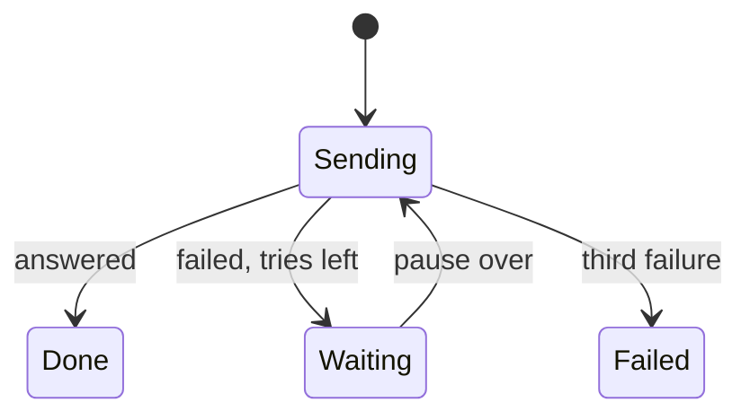

# Writing for the reader

emend-review, emend-feedback and emend-publish share these rules. Follow them for a review
writeup, a feedback reply and every document you write to publish. Each section says where it
applies. A document the user wrote is published as it is.

## Sentences

Keep each section useful to someone who has not opened the code.
Put the effect before the mechanism, explain unfamiliar terms, and cite paths you inspected.
Answer first, then give the reason and relevant validation.
Use one fact per sentence and short sentences of 20 words or fewer.

## TL;DR

Open with two or three short sentences on what this work is and why it matters for the project.
Name the issue or plan task it serves when there is one.
The reader reads it first, often straight from other work.

- A review writeup holds it in `tldr`.
  State what changes for the user, with the before state when it helps.
  `whyItMatters` says what the change gives the product or prepares for, in one or two sentences.
- A document opens with it, under a "TL;DR" heading right after the title.
  In a Markdown document, a `## TL;DR` section shows as the writeup's card.

## Callouts

This section applies to a Markdown document, a review writeup and a feedback reply.
A quote that starts with a GitHub alert marker shows as a callout.
Put the marker alone on the quote's first line:

```markdown
> [!NOTE]
> Search results stay in the cache for five minutes.
```

- `[!NOTE]` shows a note and `[!WARNING]` a warning.
- `[!TIP]` and `[!IMPORTANT]` show as notes, `[!CAUTION]` as a warning, each with its own label.
- A quote without a marker stays a plain quote.
- A callout holds text, lists and code. A quote with a Mermaid diagram stays a plain quote, so put the diagram outside it.
- An HTML page uses `<aside class="note">` or `<aside class="warning">` instead.

## No filler

Leave out a fact, a field or a line that has nothing real to say.
Never write "None", "N/A" or a sentence that only repeats its label.
Checked and Not checked are the exception. They are never empty.

## Why and Example

A review topic's `why` explains what the area does, the problem and the fix.
Its `example` shows a concrete before/after case.
Give every topic above Low risk (`skim`) an Example of at most six lines.
Keep examples grounded in the actual change: use its real input and real output.
Write a before/after case in one paragraph, with lines starting `Before:` and `After:`.
emend shows those lines as aligned rows.
A line without `Before:` or `After:` at its start continues the row above it.
Put any other note in its own paragraph.
For two or more cases, you can use a table: `Input | Before | After`.
A document that explains a change or a proposal gives the same why and a grounded example.

## State diagrams

This section applies to a review writeup.
When a topic changes how something moves between states, show those states as a diagram in that topic.
A lifecycle, a protocol, retries and a hand-off are such changes.
Other topics need no diagram.

- Put a Mermaid `stateDiagram-v2` in a `mermaid` code fence in the topic's `why`, right after the **Fix:** paragraph.
  The `why` shows open; `body` starts folded under Details.
  An **Undo:** paragraph still comes last.
- Name states and arrows in the reviewer's words, not with code names.
  Write "Waiting for review", not `PENDING_REVIEW`.
- Keep a diagram to about 20 arrows.
  For a bigger flow, merge states into broader ones, or split it into one diagram per part.
- Keep arrow labels as short as state names, or they overlap.

When the statechart skill is installed and the change is risky enough to model, use its checked chart.
A flow that can lose work, repeat a step or hang is risky enough.
Leave out the chart's `classDef` lines for `breaks` and `mayBreak`, so emend's light and dark colours apply.
Under the chart, list each bug path as one item: the rule, the reader's sentence for it, and the path.

Otherwise, write under the diagram that it was drawn by hand and not checked.
The statechart skill is never required. Never install it.

A hand-drawn diagram for the retry topic in the worked examples below:

````markdown
**Fix:** The loop stops after three attempts.



Drawn by hand, not checked.
````

A bug path from a checked chart, as one item:

```markdown
- `ChargedOnce`: an order is charged at most once. Path: Checkout → Charging → Timed out → Charging.
```

## Review verdict and risk

This section applies to a review writeup. It tells the reviewer how deep to read, and why.
The reviewer decides. Your verdict is advice, and Checked and Not checked are its evidence.

### Risk, in plain words

Give each topic one risk level in `attention`. Set the value in brackets; the app shows the word.

- Low (`skim`): a rare path, and tests cover it. Mechanical changes, renames and wording are Low.
- Medium (`review`): a common path can break, and users notice.
- High (`critical`): data loss, a security hole, money, or an outage.

Rate what breaks if the change is wrong, not what the code touches.
Touching auth is not risky by itself; breaking it is.
Most reviews have no High topic. Mark at most one topic High.
If two topics seem High, the change is too big. Say so under **Biggest risk** in `whereToLook`.

### Sensitivity

Sensitivity is a plain tag, not a level. Put it in the topic's `blastRadius.scope`.
Use `auth`, `data`, `money`, `privacy` or `network` when the topic touches one of them.
Otherwise use one word for who or what is affected.
`blastRadius.note` says how a break would show.

### Undo, in plain words

Every topic has one of three undos:

- Revert.
- Revert, then a named repair: "Revert, then rerun the import."
- Cannot be undone, with the step named: "Cannot be undone: drops column `x`."

Without a named step, the undo is a revert.
When a revert is not enough, end the topic's `why` with a paragraph of its own that starts with **Undo:**.
A feature flag does not undo writes already made.

### The verdict

`review` holds the verdict: one of three levels and one short sentence, `reason`, that says why.

- `skim` shows as "Skim, then merge.": every topic is Low risk, the undo is a revert or a revert
  plus one named repair, and the checks cover the changed behavior.
- `topics` shows as "Read topics" with their titles: one or two topics carry Medium risk or need a
  repair. List their slugs in `topics`. With more than two such topics, read everything.
- `everything` shows as "Read everything.": any High topic. Every data migration lands here.

`checked` lists what you actually ran or verified: commands, tests, manual checks.
`notChecked` lists what you did not run or verify. Neither is ever empty.
If you ran nothing, say so in `checked`.
When in doubt, pick the deeper level and say why in `reason`. Never round down.

### Data migrations

A data migration always states, in its topic:

- what data changes, and roughly how much;
- whether it can be reversed, and how;
- how it was tried: a dry run, or a copy of the data;
- what to watch after the deploy.

### Worked examples

These cases are synthetic. Three cases per level: the first shows the topics, the verdict and
its evidence; the other two are short.

**Low: skim, then merge.** A change renames `fetchUser` to `loadUser` in eight files.

- Topic "Rename the user loader": Low. The undo is a revert.
- `review`: `{ "level": "skim", "reason": "A rename that the type checker and the tests cover." }`
- `checked`: the full test suite and the type check pass.
- `notChecked`: no manual run of the app.

Two more Low cases:

- A typo fix in three error messages. The undo is a revert.
- A cache key gains a version prefix, so old entries expire. The undo: revert, then clear the cache.

**Medium: read topics.** A change caps request retries at three and rewords a settings label.

- Topic "Retry budget": Medium, because every request passes the loop. The undo is a revert.
- Topic "Settings label": Low. The undo is a revert.
- `review`: `{ "level": "topics", "topics": ["retry-budget"], "reason": "Every request passes the new retry loop." }`
- `checked`: unit tests for one, two and three failed attempts.
- `notChecked`: a real network that drops requests.

Two more Medium cases, each read as its own topic:

- The inbox shows 50 rows per page instead of 20. Every user sees it. The undo is a revert.
- A search field is renamed, and every search reads it. The undo: revert, then rerun the index
  build.

**High: read everything.** A data migration moves invoice amounts from decimals to whole cents.

- Topic "Cents migration": High, because it rewrites stored money. Its `why` ends with
  "**Undo:** Cannot be undone: drops column `amount_decimal`."
- The topic states the migration facts: it rewrites about 1.2 million invoice rows. Only the
  backup taken before the deploy reverses it. A dry run on a copy of last week's data matched every
  total to the cent. After the deploy, watch the nightly totals report and failed invoice creation.
- `review`: `{ "level": "everything", "reason": "A data migration rewrites every stored invoice amount." }`
- `checked`: the dry run on the copy and the full test suite.
- `notChecked`: the migration's run time on the live table under load.

Two more High cases, each read everything:

- Login skips the second factor on a remembered device. A mistake is a security hole.
- The billing job moves from the end to the start of the month. A mistake charges customers twice.

## Glossary

Give brief definitions of the domain terms the text uses.
Prefer existing project meanings and omit general programming terms.
Keep it to at most 12 terms and one short sentence per definition.
A review writeup holds it in `glossary` as a list of entries with `term`, `definition` and optional `aliases`.
emend marks each term's first use in every section.
It shows the definition when the reader points at it.
Add an alias for another form the text uses, such as an abbreviation.
A document keeps its glossary as a list under a "Glossary" heading, one term per item.

## Screenshots

A review writeup or a document can show images, such as before and after screenshots of a UI change.
A change the user can see needs Before and After screenshots at the same viewport.
Capture them with a headless browser.
Each project picks its own capture tool: use one the project or the user already provides.
Never add a dependency or download a browser to capture.
Capture Before from the base commit in a separate worktree or from an existing build.
Never stash, reset or check out over the working tree to reach it.
Capture with synthetic data, and crop to the change.
Never show secrets, personal data, private hostnames, URLs or paths, or real customer or client content.
If you cannot capture a shot, or a screen cannot avoid such data, skip it and say why under Where to look (`whereToLook`).

In a review writeup:

- List each image under `media`, as [the manifest reference](manifest.md) says.
- Reference it from any writeup section with ``. The alt text becomes the caption.
- Put the pair in one paragraph, with alt text "Before" and "After":
  ` `.
  On the next line of that paragraph, state the effect in one line.
  emend shows Before, After and Side by side controls, with the effect line underneath.
- Every image path in the writeup must be listed under `media`.
- Publish refuses an image path that is not listed, such as a typo in the file name.
- `emend publish` names the path, so you can fix the link or list the file.
- A path with `..`, a leading `/` or a backslash never shows. Use the listed path exactly.
- Remote image URLs do not show. List the file under `media` instead.

In a Markdown document, put the image beside it and reference it with a relative path,
``. PNG, JPEG, GIF, WebP and AVIF show; remote image URLs do not.
A Before and After pair shows the same way.

## HTML pages

These rules hold for every HTML document you write to publish.

- Keep the page self-contained. emend runs none of its scripts and loads nothing from other hosts.
  Use no CDN scripts, styles or fonts.
- Keep images and styles beside the file, using relative paths.
- Use emend's page structure below unless the user asks for a custom page.

### emend's page structure

Build the page from these elements. It needs no CSS.
emend adds its own styles to every page it serves, unless the page is marked custom.
The page then has the fonts, colours, sizes and spacing of a Markdown document.
It follows emend's light or dark mode.

- Title and sections: `h1` for the title, `h2` and `h3` for sections.
  Contents lists the `h2` and `h3` headings.
- Text: `p`, `ul`, `ol`, `a`, `strong`, `em`, `code`, `pre` with `code`, `blockquote`, `table`,
  `hr`, `kbd` and `dl`.
- Code: `<pre><code class="language-ts">` shows the code in the same colours as a Markdown fence.
- TL;DR: `<section class="tldr">` with the "TL;DR" heading first. It shows as the writeup's card.
- Key facts: `<dl class="facts">`, with one `div` holding a `dt` and a `dd` per fact.
- Figure: `figure` with an `img` and a `figcaption`.
- Diagram: `<pre class="mermaid">` holding Mermaid source.
  `<pre><code class="language-mermaid">`, the form a Markdown fence becomes, works too.
  Escape `<` as `&lt;` and `&` as `&amp;` in the source, because emend reads the `pre`'s text.
  emend draws it with its own Mermaid, in light and dark mode, also on a custom page.
  Opened on its own outside emend, the page shows the source.
- Before and After: `<div class="pair">` with two figures captioned "Before" and "After".
  A `p` after them states the effect.
- Callout: `<aside class="note">` or `<aside class="warning">`.
- Collapsible section: `details` with a `summary`.
- Status label: `<span class="status">`. Add `ok`, `warn` or `bad` for green, amber or red.
- Containers such as `main`, `section`, `div` and `span` are fine.

`emend publish` names the elements a page uses outside this structure.
emend's look has no styles for them.

```html
<!doctype html>
<html lang="en">
<head>
<meta charset="utf-8">
<title>Search cache</title>
</head>
<body>
<h1>Search cache</h1>
<section class="tldr">
  <h2>TL;DR</h2>
  <p>Search now answers from a five-minute cache. A search takes 40 ms instead of 900 ms.</p>
</section>
<dl class="facts">
  <div><dt>Status</dt><dd><span class="status ok">Live</span></dd></div>
  <div><dt>Undo</dt><dd>Turn the cache flag off.</dd></div>
</dl>
<h2>What changed</h2>
<p>Search reads the cache first and falls back to the database.</p>
<pre class="mermaid">
flowchart LR
  Search --> Cache
  Cache -->|Miss| Database
</pre>
<aside class="warning"><p>A price change shows after at most five minutes.</p></aside>
<div class="pair">
  <figure><figcaption>Before</figcaption></figure>
  <figure><figcaption>After</figcaption></figure>
  <p>Results appear without the spinner.</p>
</div>
<details>
  <summary>How it was measured</summary>
  <p>1000 searches for the same term, run against a local build.</p>
</details>
</body>
</html>
```

### The page's own copy of emend's look

emend adds its look only while it serves the page.
To give the file itself that look when opened on its own, run `emend look <file.html>` after writing it.
Run it again after each change.
The file follows the reader's light or dark mode.
It uses the user's theme when exactly one is valid.
`--theme <name>` picks one; `--no-theme` uses none.
The file stays self-contained, with about 200 KB more for the fonts.
A custom page is left unchanged.
Publishing still works the same.

### Your own styles

emend's styles sit in a cascade layer, so each of your own rules wins over them.
Add a few rules when the structure above is not enough. The rest of the page keeps emend's look.

When your styles set colours, style both modes.
Put the dark colours in a `@media (prefers-color-scheme: dark)` rule in a `style` element, or use
`light-dark()`.
A page that sets colours without such a rule shows in light mode only, also while emend is dark,
so its text stays readable.
Colours count when a `style` element or `style` attribute sets one, when an attribute such as
`bgcolor` or an SVG `fill` or `stroke` sets one, and when the page links or imports a stylesheet:
emend does not read those files.

### Custom pages

When the user asks for a custom page, mark it in its `head` with
`<meta name="emend-look" content="custom">`.
emend then shows the page with its own styles only.
Diagrams use the same `<pre class="mermaid">` markup.
On a custom page:

- Give the main column a max width of 1024px.
- Use body text around 18px with a line height around 1.65.

`emend publish` says for each HTML page whether it shows in emend's look or as a custom page,
and why. It also says when a page shows in light mode only.
