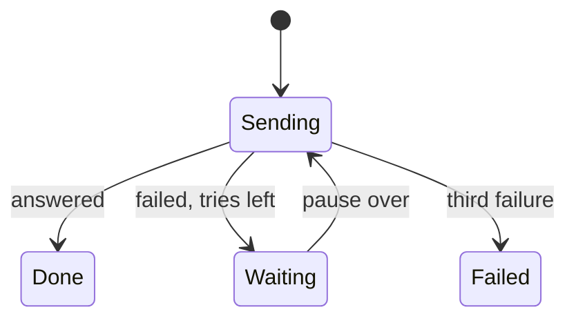
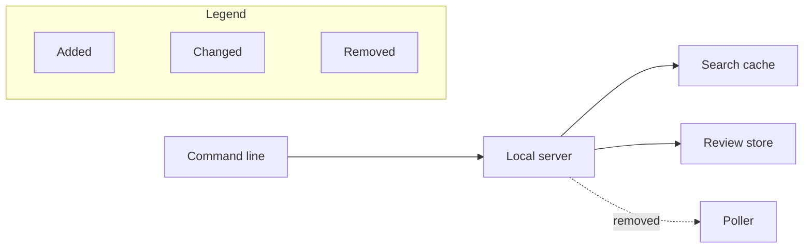

# Writing for the reader

emend-review, emend-feedback and emend-publish share these rules. Follow them for a review
writeup, a feedback reply and every document you write to publish. Each section says where it
applies. A document the user wrote is published as it is.

## Sentences

Keep each section useful to someone who has not opened the code.
Put the effect before the mechanism, explain unfamiliar terms, and cite paths you inspected.
Answer first, then give the reason and relevant validation.
Use one fact per sentence and short sentences of 20 words or fewer.

## Titles and paragraphs

This section applies to a review writeup.

- A topic title names the effect and the stake: "Failed requests stop after three tries", not
  "Retry changes".
- The first sentence of each paragraph carries its point.
- Keep a paragraph to two or three sentences.

A document follows these rules loosely: a TL;DR first, short sections, the point first.

## TL;DR

Open with two or three short sentences on what this work is and why it matters for the project.
Name the issue or plan task it serves when there is one.
The reader reads it first, often straight from other work.

- A review writeup holds it in `tldr`.
  State what changes for the user, with the before state when it helps.
  `whyItMatters` says what the change gives the product or prepares for, in one or two sentences.
- A document opens with it, under a "TL;DR" heading right after the title.
  In a Markdown document, a `## TL;DR` section shows as the writeup's card.

## Callouts

This section applies to a Markdown document, a review writeup and a feedback reply.
A quote that starts with a GitHub alert marker shows as a callout.
Put the marker alone on the quote's first line:

```markdown
> [!NOTE]
> Search results stay in the cache for five minutes.
```

- `[!NOTE]` shows a note and `[!WARNING]` a warning.
- `[!TIP]` and `[!IMPORTANT]` show as notes, `[!CAUTION]` as a warning, each with its own label.
- A quote without a marker stays a plain quote.
- A callout holds text, lists and code. A quote with a Mermaid diagram stays a plain quote, so put the diagram outside it.
- An HTML page uses `<aside class="note">` or `<aside class="warning">` instead.

## No filler

Leave out a fact, a field or a line that has nothing real to say.
Never write "None", "N/A" or a sentence that only repeats its label.
Checked, Not checked and Deviations are the exception. They are never empty.

## Why and Example

A review topic's `why` explains what the area does, the problem and the fix.
Its `example` shows a concrete before/after case.
Give every topic above Low risk (`skim`) an Example of at most six lines.
Keep examples grounded in the actual change: use its real input and real output.
Write a before/after case in one paragraph, with lines starting `Before:` and `After:`.
emend shows those lines as aligned rows.
A line without `Before:` or `After:` at its start continues the row above it.
Put any other note in its own paragraph.
For two or more cases, you can use a table: `Input | Before | After`.
A document that explains a change or a proposal gives the same why and a grounded example.

## State diagrams

This section applies to a review writeup.
When a topic changes how something moves between states, show those states as a diagram in that topic.
A lifecycle, a protocol, retries and a hand-off are such changes.
Other topics need a diagram only when it shows what you claim, as "Pictures" says.

- Put a Mermaid `stateDiagram-v2` in a `mermaid` code fence in the topic's `why`, right after the **Fix:** paragraph.
  The `why` shows open; `body` starts folded under Details.
  An **Undo:** paragraph still comes last.
- Name states and arrows in the reviewer's words, not with code names.
  Write "Waiting for review", not `PENDING_REVIEW`.
- Keep a diagram to about 20 arrows.
  For a bigger flow, merge states into broader ones, or split it into one diagram per part.
- Keep arrow labels as short as state names, or they overlap.

When the statechart skill is installed and the change is risky enough to model, use its checked chart.
A flow that can lose work, repeat a step or hang is risky enough.
Leave out the chart's `classDef` lines for `breaks` and `mayBreak`, so emend's light and dark colours apply.
Under the chart, list each bug path as one item: the rule, the reader's sentence for it, and the path.

Otherwise, write under the diagram that it was drawn by hand and not checked.
The statechart skill is never required. Never install it.

A hand-drawn diagram for the retry topic in the worked examples below:

````markdown
**Fix:** The loop stops after three attempts.



Drawn by hand, not checked.
````

A bug path from a checked chart, as one item:

```markdown
- `ChargedOnce`: an order is charged at most once. Path: Checkout → Charging → Timed out → Charging.
```

## Change graphs

This section applies to a review writeup. A document that explains a change follows it loosely.
Draw a change graph when a change crosses two or more parts, or adds a flow.
A part is a package, a service, a module or a group of files the reviewer would name.

- Put a Mermaid `flowchart LR` in a `mermaid` code fence in a topic's `why`, right after the **Fix:** paragraph. Use the topic the graph explains, or the first topic for the whole change.
- Keep the graph out of `overview`: a third block there stops Goal and Change showing side by side.
- Give each part one node, named in the reviewer's words.
- Mark parts with `:::added`, `:::changed` or `:::removed`.
  Leave parts the change only reaches unmarked.
- Draw a removed arrow as `-.->|removed|`.
- Leave out `classDef` lines for these classes, so emend's light and dark colours apply.
  A removed part is dashed as well as red, so it reads without colour.
- Every change graph carries a legend inside the picture: a `Legend` subgraph with one node per
  class the graph uses, joined by `~~~`.
- Keep a graph to about 20 arrows. For a bigger change, merge parts into broader ones.



### Dependency graphs

When the reviewer must judge what a change reaches, add a dependency graph after the change graph.
Limit it to the changed files and their direct neighbours: the files they import and the files that import them.
Print it as Mermaid with a dependency tool the project already has, on your machine.
Run such a tool only in a working tree whose install, build and tests already ran in this task.
Every change there that has not run yet must be your own.
Also run it without the project's config, and never through a package script or `npx`.
These are extra guards, not the boundary.
For example, dependency-cruiser prints a file and its direct neighbours with `--no-config`, `--focus` and `--output-type mermaid`.
Never install a tool or fetch one for this.
For code you did not write, or without such a tool, draw the graph by hand.
Read the changed files' imports, and search the project for the files that import them.
Write under a hand-drawn graph that it was drawn by hand.
Mark the changed files with the change classes and add the legend.
Over about 20 arrows, group files by folder.

### Diagram types

emend draws these Mermaid types in light and dark mode: `flowchart`, `stateDiagram-v2`,
`sequenceDiagram`, `erDiagram`, `xychart`, `block` and `timeline`.
The `xychart-beta` and `block-beta` forms draw too.
`C4Context` draws, but it keeps its own colours, and its arrow labels are faint in dark mode.
Draw a flowchart instead.
Other types are not checked, so use one of these.

## Risk and proof

This section applies to a review writeup. The writeup is a decision brief: the reviewer decides
from it whether the change passes. Rate the risk, show the proof, and leave the verdict to the
reviewer.

### Risk, in plain words

Give each topic one risk level in `attention`. Set the value in brackets; the app shows the word.

- Low (`skim`): a rare path, and tests cover it. Mechanical changes, renames and wording are Low.
- Medium (`review`): a common path can break, and users notice.
- High (`critical`): data loss, a security hole, money, or an outage.

Rate what breaks if the change is wrong, not what the code touches.
Touching auth is not risky by itself; breaking it is.
Most reviews have no High topic. Mark at most one topic High.
If two topics seem High, the change is too big. Say so under **Biggest risk** in `whereToLook`.

### Sensitivity

Sensitivity is a plain tag, not a level. Put it in the topic's `blastRadius.scope`.
Use `auth`, `data`, `money`, `privacy` or `network` when the topic touches one of them.
Otherwise use one word for who or what is affected.
`blastRadius.note` says how a break would show.

### Undo, in plain words

Every topic has one of three undos:

- Revert.
- Revert, then a named repair: "Revert, then rerun the import."
- Cannot be undone, with the step named: "Cannot be undone: drops column `x`."

Without a named step, the undo is a revert.
When a revert is not enough, end the topic's `why` with a paragraph of its own that starts with **Undo:**.
A feature flag does not undo writes already made.

### No verdict

Leave `review` out of the writeup. The reviewer gives the verdict, not you.
A choice the reviewer must make goes into `needsYou`.

### Where to look

`whereToLook` holds two labelled lines:

- **Biggest risk:** one concrete case of what goes wrong, and for whom.
  "The retry loop changed" names an area. "A request that fails three times shows the user an
  empty list, with no error" is a case.
- **Look yourself:** at most three spots, each with why no test settles it.
  "`src/retry.ts`, where the loop counts attempts: the tests fake the clock" is one spot.

### Checked and Not checked

`checked` holds the proof: at most five items, strongest first. Each item says what it showed:
"A test that fails the third attempt failed before the fix and passes now."
Leave out process, such as running the gate, the linter or the type check, or reading the diff.
`notChecked` holds only real gaps, each with what could go wrong.
Neither is ever empty. If you ran nothing, say so in `checked`.

The higher the risk, the stronger the proof. A data migration shows row counts and sums before
and after, plus a few sample rows.

### Needs you

Write one line per item in `needsYou`, at most four:

- Decide (`decide`): a choice only the reviewer can make.
- Accept (`accept`): a risk or trade-off the reviewer takes on knowingly.
- Confirm drift (`confirm-drift`): a departure from the request that needs a yes.
- Answer (`answer`): a question the work waits on.

Name the topic slug when the item belongs to one. Use `[]` when nothing needs the reviewer.
Write it only with first-hand intent, alongside `decisions`; with `decisions: null`, leave it out.

### Decisions

Keep a line in `decisions` only if the reviewer might decide, or judge the risk, differently
because of it. Write it in this order:

- **Decided for you:** one line per choice nobody asked for, in the form "Chose X over Y
  because Z. Would change if W."
- Drift: each departure from the user's latest stated intent, marked as drift, with the short
  request it departs from quoted.
- **Trail:** process facts in a short list, such as the independent review findings and whether
  they were fixed, disputed or remain open, or that no independent review ran.

### Data migrations

A data migration always states, in its topic:

- what data changes, and roughly how much;
- whether it can be reversed, and how;
- how it was tried: a dry run or a copy of the data, with row counts and sums before and after,
  and a few sample rows;
- what to watch after the deploy.

### Worked examples

These cases are synthetic. Each shows a topic, the brief's lines and its proof.

**Low.** A change renames `fetchUser` to `loadUser` in eight files.

- Topic "User pages keep loading after the loader rename": Low. The undo is a revert.
- **Biggest risk:** a call the type checker cannot see, such as a lookup by string, still asks
  for `fetchUser`, and that page fails to load.
- `checked`: a search finds no `fetchUser` outside the changelog.
- `notChecked`: plugins outside this repository; one that calls `fetchUser` breaks on upgrade.

**Medium.** A change caps request retries at three.

- Topic "Failed requests stop after three tries": Medium, because every request passes the loop.
  The undo is a revert.
- **Biggest risk:** a request that fails a third time shows the user an empty list, with no
  error.
- **Look yourself:** `src/retry.ts`, where the loop counts attempts: the tests fake the clock, so
  they cannot show real pauses.
- `checked`: tests for one, two and three failed attempts; the third shows the error message.
- `notChecked`: a real network that drops requests; a slow server could reach the cap sooner.

**High.** A data migration moves invoice amounts from decimals to whole cents.

- Topic "Stored invoice amounts become whole cents": High, because it rewrites stored money. Its
  `why` ends with "**Undo:** Cannot be undone: drops column `amount_decimal`."
- The topic states the migration facts: it rewrites about 1.2 million invoice rows. Only the
  backup taken before the deploy reverses it. After the deploy, watch the nightly totals report
  and failed invoice creation.
- `checked`: a dry run on a copy of last week's data. Before: 1,204,311 rows summing to
  48,113,902.17. After: the same rows, summing to 4,811,390,217 cents. Five sample rows match to
  the cent.
- `notChecked`: the run time on the live table under load; a long lock could block new invoices.
- `needsYou`: `[{ "kind": "decide", "text": "Run it in the nightly window, or now with a short lock?" }]`

## Intent reviews

This section applies to an intent review: the short review a larger change gets before any code.
Keep it short enough to read in two minutes.

- `tldr`: what the change does, and the issue or plan task it serves.
- `whyItMatters`: why the change is worth doing.
- `overview`: **Goal** is the end state. **Change** is the approach: the parts you will touch, and how.
- One topic per part you will change, with the risk you expect in `attention`, as "Risk and proof"
  rates it. Its `why` says what will change there and why. An Example is not needed.
- `needsYou`: the decisions you expect to need, as `decide` items, at most four. `[]` when you expect
  none. Write `decisions` as usual.
- `whereToLook`: **Biggest risk** is the case most likely to go wrong.
- `checked`: what you read or tried to plan the change. `notChecked`: what only the code will show.

### Deviations

This section applies to a code review whose manifest names its intent review in `intentReview`.
`writeup.deviations` shows as "Deviations from the approved intent".

- One item per departure from the approved intent: what the intent said, what the code does, and why.
- Name the topic that holds the deviation.
- A deviation the reviewer must accept also goes into `needsYou` as a `confirm-drift` item.
- When the code follows the intent, write "None." It is never empty.

## Glossary

Give brief definitions of the domain terms the text uses.
Prefer existing project meanings and omit general programming terms.
Keep it to at most 12 terms and one short sentence per definition.
A review writeup holds it in `glossary` as a list of entries with `term`, `definition` and optional `aliases`.
emend marks each term's first use in every section.
It shows the definition when the reader points at it.
Add an alias for another form the text uses, such as an abbreviation.
A document keeps its glossary as a list under a "Glossary" heading, one term per item.

## Pictures

Show what you claim. A review writeup or a document can show images.
A review writeup follows the two rules below; a document follows them loosely.

- A change the user can see needs a screenshot. Show Before and After at the same viewport.
  A single shot, or an After-only shot when there is no Before, is fine.
- A change without a UI gets a picture too, such as a terminal transcript in a code block, or a
  table as "Tables" says.

Capture screenshots with a headless browser.
Each project picks its own capture tool: use one the project or the user already provides.
Never add a dependency or download a browser to capture.
Capture Before from the base commit in a separate worktree or from an existing build.
Never stash, reset or check out over the working tree to reach it.
Capture with synthetic data, and crop to the change.
Never show secrets, personal data, private hostnames, URLs or paths, or real customer or client content.
If you cannot capture a shot, or a screen cannot avoid such data, skip it and say why under Not checked (`notChecked`).

In a review writeup:

- List each image under `media`, as [the manifest reference](manifest.md) says.
- Reference it from any writeup section with ``. The alt text becomes the caption.
- Put the pair in one paragraph, with alt text "Before" and "After":
  ` `.
  On the next line of that paragraph, state the effect in one line.
  emend shows Before, After and Side by side controls, with the effect line underneath.
- A third image with alt text "Diff" may follow the pair in the same paragraph:
  `  `.
  emend then adds a Diff control that shows that image alone.
  Make the diff from the two shots on your machine, with an image diff tool the project or the
  user already provides. Never add a dependency to the repo under review or download a tool for it.
  Without such a tool, leave the Diff image out.
- Every image path in the writeup must be listed under `media`.
- Publish refuses an image path that is not listed, such as a typo in the file name.
- `emend publish` names the path, so you can fix the link or list the file.
- A path with `..`, a leading `/` or a backslash never shows. Use the listed path exactly.
- Remote image URLs do not show. List the file under `media` instead.

In a Markdown document, put the image beside it and reference it with a relative path,
``. PNG, JPEG, GIF, WebP and AVIF show; remote image URLs do not.
A Before and After pair, with or without a Diff image, shows the same way.

## Tables

This section applies to a review writeup. A document follows it loosely.

Show these changes as a table:

- A config change: one row per key path, with Before and After.
- A schema change: the columns, with their type and what changed.
- Numbers: Before, After and the change.

Show a query plan as its steps, one per line.

## HTML pages

These rules hold for every HTML document you write to publish.

- Keep the page self-contained. emend runs none of its scripts and loads nothing from other hosts.
  Use no CDN scripts, styles or fonts.
- Keep images and styles beside the file, using relative paths.
- Use emend's page structure below unless the user asks for a custom page.

### emend's page structure

Build the page from these elements. It needs no CSS.
emend adds its own styles to every page it serves, unless the page is marked custom.
The page then has the fonts, colours, sizes and spacing of a Markdown document.
It follows emend's light or dark mode.

- Title and sections: `h1` for the title, `h2` and `h3` for sections.
  Contents lists the `h2` and `h3` headings.
- Text: `p`, `ul`, `ol`, `a`, `strong`, `em`, `code`, `pre` with `code`, `blockquote`, `table`,
  `hr`, `kbd` and `dl`.
- Code: `<pre><code class="language-ts">` shows the code in the same colours as a Markdown fence.
- TL;DR: `<section class="tldr">` with the "TL;DR" heading first. It shows as the writeup's card.
- Key facts: `<dl class="facts">`, with one `div` holding a `dt` and a `dd` per fact.
- Figure: `figure` with an `img` and a `figcaption`.
- Diagram: `<pre class="mermaid">` holding Mermaid source.
  `<pre><code class="language-mermaid">`, the form a Markdown fence becomes, works too.
  Escape `<` as `&lt;` and `&` as `&amp;` in the source, because emend reads the `pre`'s text.
  emend draws it with its own Mermaid, in light and dark mode, also on a custom page.
  Opened on its own outside emend, the page shows the source.
- Before and After: `<div class="pair">` with two figures captioned "Before" and "After".
  A `p` after them states the effect.
- Callout: `<aside class="note">` or `<aside class="warning">`.
- Collapsible section: `details` with a `summary`.
- Status label: `<span class="status">`. Add `ok`, `warn` or `bad` for green, amber or red.
- Containers such as `main`, `section`, `div` and `span` are fine.

`emend publish` names the elements a page uses outside this structure.
emend's look has no styles for them.

```html
<!doctype html>
<html lang="en">
<head>
<meta charset="utf-8">
<title>Search cache</title>
</head>
<body>
<h1>Search cache</h1>
<section class="tldr">
  <h2>TL;DR</h2>
  <p>Search now answers from a five-minute cache. A search takes 40 ms instead of 900 ms.</p>
</section>
<dl class="facts">
  <div><dt>Status</dt><dd><span class="status ok">Live</span></dd></div>
  <div><dt>Undo</dt><dd>Turn the cache flag off.</dd></div>
</dl>
<h2>What changed</h2>
<p>Search reads the cache first and falls back to the database.</p>
<pre class="mermaid">
flowchart LR
  Search --> Cache
  Cache -->|Miss| Database
</pre>
<aside class="warning"><p>A price change shows after at most five minutes.</p></aside>
<div class="pair">
  <figure><figcaption>Before</figcaption></figure>
  <figure><figcaption>After</figcaption></figure>
  <p>Results appear without the spinner.</p>
</div>
<details>
  <summary>How it was measured</summary>
  <p>1000 searches for the same term, run against a local build.</p>
</details>
</body>
</html>
```

### The page's own copy of emend's look

emend adds its look only while it serves the page.
To give the file itself that look when opened on its own, run `emend look <file.html>` after writing it.
Run it again after each change.
The file follows the reader's light or dark mode.
It uses the user's theme when exactly one is valid.
`--theme <name>` picks one; `--no-theme` uses none.
The file stays self-contained, with about 200 KB more for the fonts.
A custom page is left unchanged.
Publishing still works the same.

### Your own styles

emend's styles sit in a cascade layer, so each of your own rules wins over them.
Add a few rules when the structure above is not enough. The rest of the page keeps emend's look.

When your styles set colours, style both modes.
Put the dark colours in a `@media (prefers-color-scheme: dark)` rule in a `style` element, or use
`light-dark()`.
A page that sets colours without such a rule shows in light mode only, also while emend is dark,
so its text stays readable.
Colours count when a `style` element or `style` attribute sets one, when an attribute such as
`bgcolor` or an SVG `fill` or `stroke` sets one, and when the page links or imports a stylesheet:
emend does not read those files.

### Custom pages

When the user asks for a custom page, mark it in its `head` with
`<meta name="emend-look" content="custom">`.
emend then shows the page with its own styles only.
Diagrams use the same `<pre class="mermaid">` markup.
On a custom page:

- Give the main column a max width of 1024px.
- Use body text around 18px with a line height around 1.65.

`emend publish` says for each HTML page whether it shows in emend's look or as a custom page,
and why. It also says when a page shows in light mode only.
